# MayudevID - Maulana Yusuf

Brand personal untuk karya dan perjalanan saya sebagai Mobile Developer, berfokus pada pengembangan aplikasi Android dan iOS menggunakan Flutter serta integrasi teknologi native.

- Lokasi: Tangerang Selatan
- Email: [ymaulana089@gmail.com](mailto:ymaulana089@gmail.com)
- LinkedIn: [Maulana Yusuf](https://www.linkedin.com/in/maulana-yusuf-b87393201)
- GitHub: [mayudevID](https://github.com/mayudevID)

---

<!-- PORTFOLIO:SECTION -->
## Tentang Saya

Mobile Developer dengan latar belakang S1 Sistem Informasi dan pengalaman membangun, mengembangkan, serta memelihara aplikasi Android dan iOS menggunakan Flutter maupun integrasi teknologi native. Berpengalaman mengerjakan implementasi antarmuka pengguna, integrasi API, manajemen state, hingga deployment aplikasi.

Fokus utama saya adalah:

- Pengembangan fitur end-to-end di aplikasi mobile
- Integrasi API, manajemen data, dan state management
- Kualitas aplikasi, performa, dan stabilitas rilis

---

<!-- PORTFOLIO:SECTION -->
## Pengalaman

### Flutter Developer
**PT Aneka Bintang Gading (Holywings Group)** | Mei 2026 - Sekarang

- Mengembangkan sistem pembelajaran internal untuk lebih dari 4.000 karyawan menggunakan React, Laravel, dan Flutter, mencakup web administrasi, backend, dan aplikasi mobile dengan fitur onboarding, learning path, pelatihan technical dan soft skill, serta kuis evaluasi
- Mengembangkan dan memelihara aplikasi mobile internal perusahaan menggunakan Flutter, termasuk pembaruan UI, fitur media sosial, artikel, group chat, dan peningkatan sistem absensi
- Mengembangkan platform manajemen agency dan talent end-to-end menggunakan Flutter dan Laravel, mencakup administrasi, absensi berbasis geolocation dan face verification, penempatan, kontrak, payroll, serta role-based access control
- Menangani database, scheduled jobs, deployment, production troubleshooting, dan rilis aplikasi ke Google Play dan Apple App Store

### Staff Mobile Programmer
**PT Kreasindo Karya Abadi** | Mei 2024 - Apr 2026

- Mengembangkan aplikasi mobile Android dan iOS menggunakan Flutter dan Dart
- Membangun dan mengimplementasikan berbagai fitur pada 3 aplikasi mobile berskala kompleks, termasuk 1 aplikasi production:
	- Integrasi API
	- Manajemen data
	- Liveness Detection (face detection)
	- Chat dan panggilan suara/video (LiveKit, CallKit iOS)
	- Notifikasi real-time (FCM)
	- Filter AR (Augmented Reality)
	- Sistem pembayaran
- Berkontribusi pada stabilitas aplikasi komunitas dengan error rate sekitar 1.03% dan rating 4.03/5
- Mendukung pertumbuhan pengguna aktif harian hingga rata-rata 12 ribu (April 2025)

### Flutter Mobile Developer - Internship
**PT Suitmedia Kreasi Indonesia** | Feb 2023 - Jun 2023

- Berkontribusi dalam pengembangan aplikasi mobile menggunakan Flutter dan Dart, dengan fokus pada implementasi antarmuka pengguna dan fungsionalitas aplikasi
- Mengelola source code menggunakan Git dan berkolaborasi melalui workflow version control
- Berpartisipasi dalam implementasi fitur, perbaikan bug, dan pengujian aplikasi
- Berkomunikasi dengan tim untuk membahas kebutuhan proyek, menyelesaikan masalah teknis, dan menyampaikan progres

---

<!-- PORTFOLIO:SECTION -->
## Pendidikan

### Universitas Pembangunan Nasional Veteran Jakarta
S1 Sistem Informasi, IPK 3.95/4.00 | Sep 2020 - Jul 2024

- Fokus studi:
	- Logika, analisis, dan algoritma pemecahan masalah
	- Pengembangan sistem informasi berbasis web dan mobile
	- Dasar machine learning dan analisis data
	- Analisis dan perancangan sistem menggunakan DFD, ERD, dan UML
	- Dokumentasi sistem dan spesifikasi kebutuhan

---

<!-- PORTFOLIO:SECTION -->
## Keterampilan

### Hard Skills

- Flutter (Dart)
- Android dan iOS development tools
- Version control: Git, GitHub, GitLab
- IDE: VS Code, Xcode, Android Studio
- CI/CD: Fastlane, Codemagic
- Laravel (PHP)
- React.js (JavaScript)

### Soft Skills

- Problem-solving
- Critical thinking
- Communication
- Teamwork

---

<!-- PORTFOLIO:SECTION -->
## Sertifikasi dan Pelatihan

- Menjadi Android Developer Expert - Dicoding (2022)
- Menjadi Flutter Developer Expert - Dicoding (2022)

---

<!-- PORTFOLIO:SECTION -->
## Proyek Unggulan

### Holy Smart

Holy Smart adalah platform pembelajaran karyawan HW Group untuk mendukung onboarding, peningkatan kompetensi, pengembangan individu, dan sertifikasi secara terstruktur. Platform full-stack ini mencakup aplikasi mobile yang dibangun dengan Flutter, admin web dengan React, serta API Laravel yang melayani aplikasi mobile dan web.

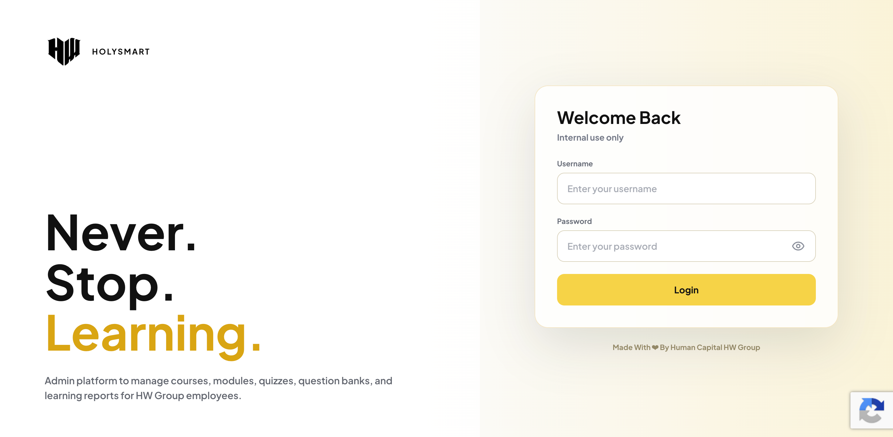

**Fitur Utama**

- Learning Journey untuk onboarding dan pengembangan kompetensi
- Course dan materi belajar berupa video, PDF, dan modul
- Test dan kuis dengan penilaian
- Pantau progres, riwayat, dan tenggat pembelajaran
- Sertifikat setelah menyelesaikan Learning Journey tertentu

	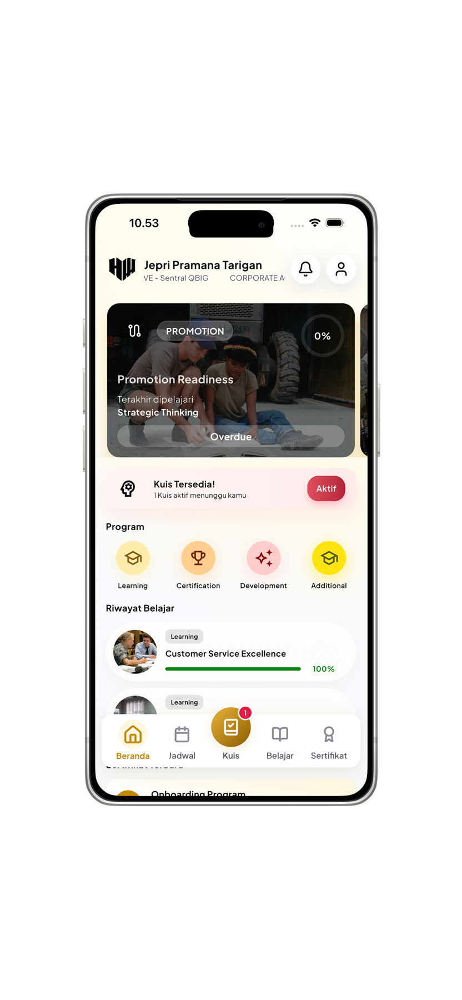
	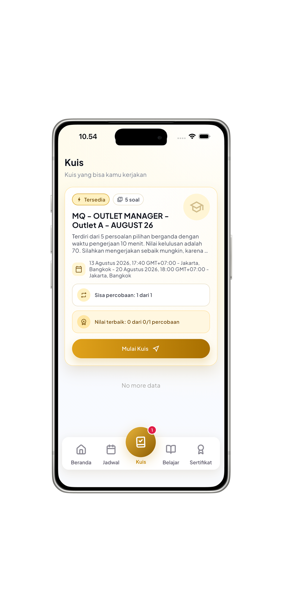
	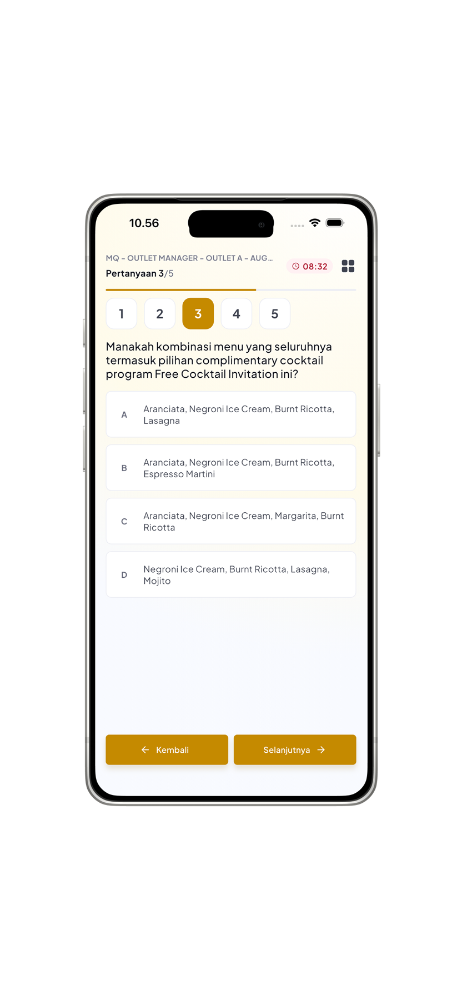
	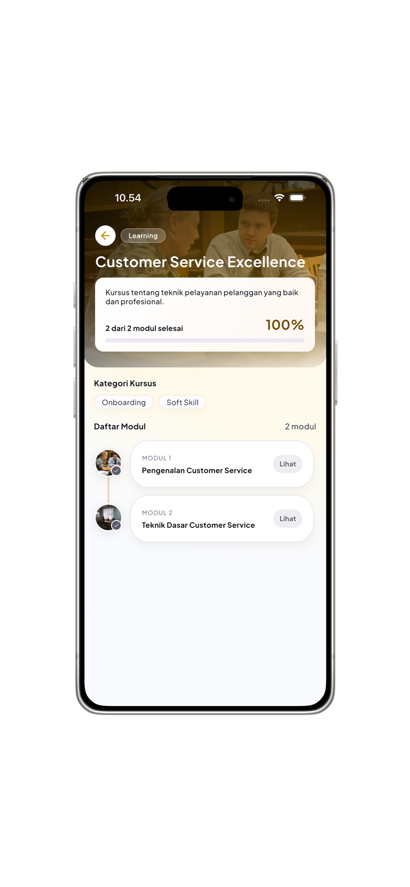

  
  

<!-- PORTFOLIO:SECTION -->
### Holy World

Aplikasi absensi untuk karyawan HW Group.

**Fitur Utama**

- Absensi masuk dan pulang
- Riwayat absensi dengan foto
- Pengingat absensi dan alarm
- Jadwal kerja, pergantian shift, dan pengajuan perubahan absensi
- Pengelolaan aset

	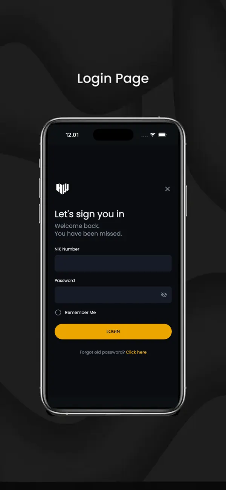
	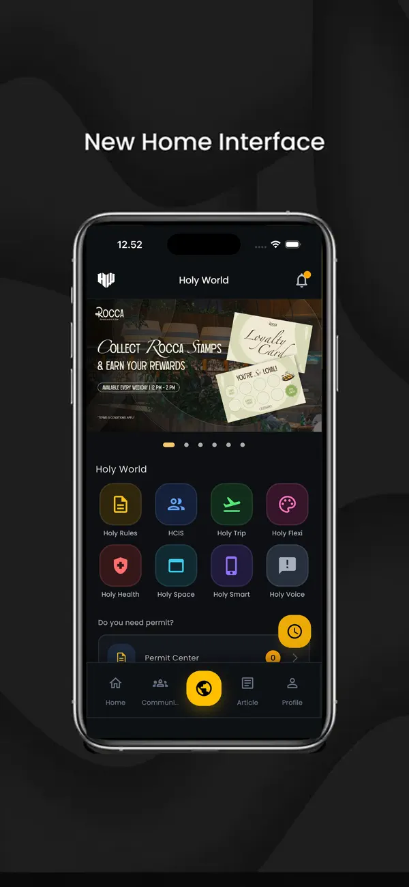
	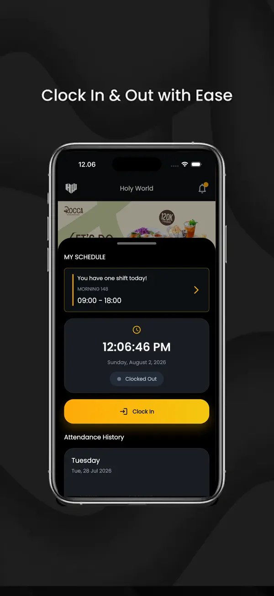
	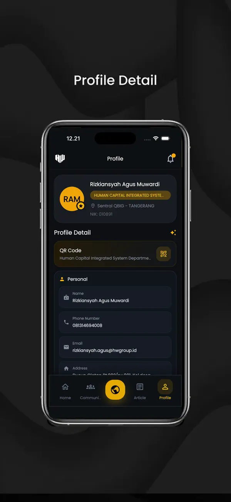
	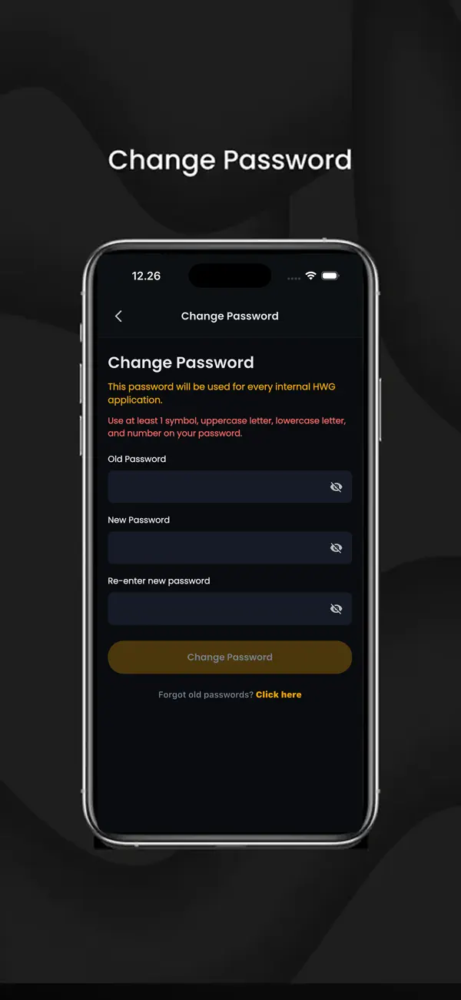

  
  

<!-- PORTFOLIO:SECTION -->
### Ar-Rauda - Kajian Islam dan Murottal Al-Qur'an

Ar-Rauda adalah aplikasi kajian Islam yang menghadirkan koleksi murottal Al-Qur'an, kajian, dan materi keagamaan lainnya.

**Fitur Utama**

- Kajian Islam & Murottal Al-Qur'an
- Mendengarkan kajian bersama
- Kajian Live Streaming
- Buat catatan kajian
- Notifikasi dan pengingat salat
- Baca Al-Qur'an dan tajwid
- Dzikir pagi & petang
- Roadmap belajar Islam (materi terstruktur)

	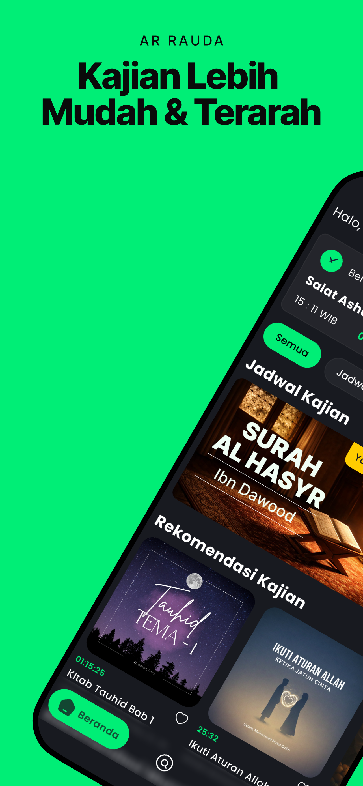
	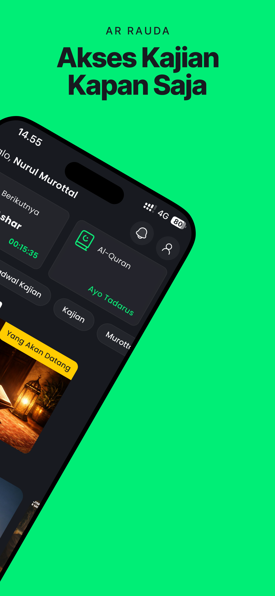
	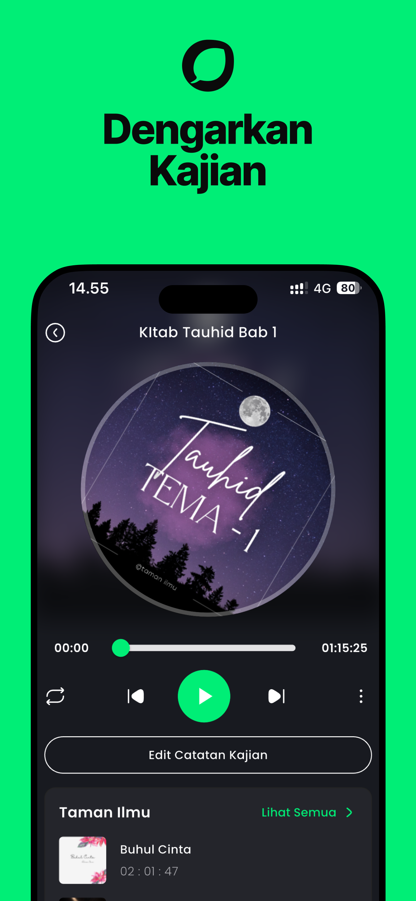
	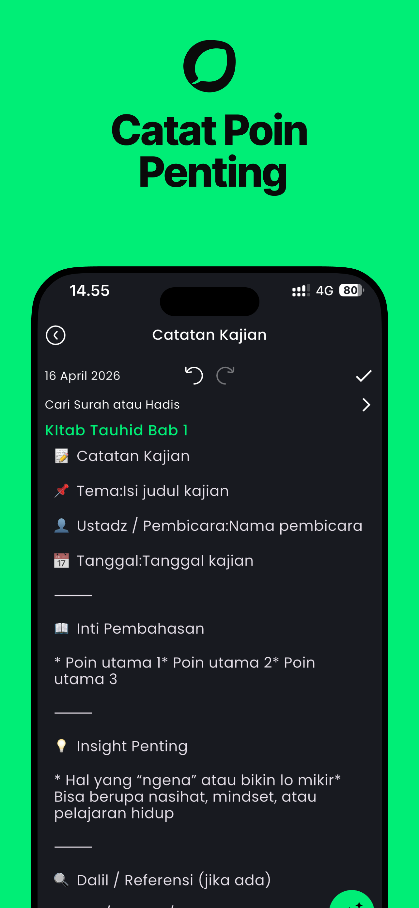
	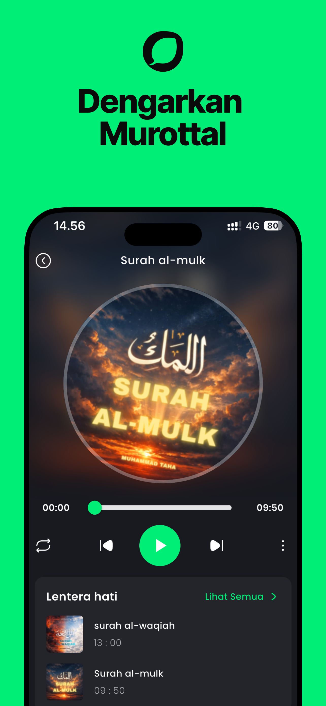

  

  

<!-- PORTFOLIO:SECTION -->
### Bloom - Productivity App

Bloom adalah aplikasi produktivitas harian dengan fitur To-do List, Pomodoro Timer, Habit Tracker, dan reminder berbasis notifikasi.

**Core Stack**

- Flutter (Dart)
- Firebase: Auth, Firestore, Storage, Analytics

**Architecture & Engineering**

- State management: BLoC (`bloc`, `flutter_bloc`) + GetX (`get`) pada alur tertentu
- Model/data layer: `equatable`, `dartz`, `json_serializable`, `json_annotation`
- Offline persistence: `shared_preferences`
- Network awareness: `connectivity_plus`

Repository: [github.com/mayudevID/bloom](https://github.com/mayudevID/bloom)

<!-- PORTFOLIO:SECTION -->
### Cling! - Money Manager App

Cling! adalah aplikasi money management untuk tracking pemasukan-pengeluaran, budgeting, dan monitoring kondisi finansial.

**Core Stack**

- Flutter (Dart)
- Firebase: Auth, Firestore, Storage, Messaging, Crashlytics, Analytics

**Architecture & Engineering**

- State management: BLoC (`bloc`, `flutter_bloc`)
- Dependency injection: `get_it`
- Local database: `sqflite`
- Local key-value storage: `shared_preferences`
- Network awareness: `connectivity_plus`

Repository: [github.com/mayudevID/cling](https://github.com/mayudevID/cling)

<!-- PORTFOLIO:SECTION -->
### KBBI Daring App

Aplikasi Android untuk pencarian kosakata KBBI berbasis API daring.

**Core Stack**

- Kotlin + Android SDK (minSdk 21, targetSdk 33)
- Retrofit + Gson converter untuk konsumsi API

**Architecture & Engineering**

- Local data layer: Room (`room-runtime`, `room-ktx`) + `kapt`
- Async programming: Kotlin Coroutines (`kotlinx-coroutines-android`)
- Screen navigation: AndroidX Navigation (`navigation-fragment-ktx`, `navigation-ui-ktx`)

Repository: [github.com/mayudevID/kbbi_daring_app](https://github.com/mayudevID/kbbi_daring_app)

---

<!-- PORTFOLIO:SECTION -->
## Kontak

Terbuka untuk kolaborasi dan peluang kerja full-time di bidang Mobile Development.

- Email: [ymaulana089@gmail.com](mailto:ymaulana089@gmail.com)
- LinkedIn: [linkedin.com/in/maulana-yusuf-b87393201](https://www.linkedin.com/in/maulana-yusuf-b87393201)
- GitHub: [github.com/mayudevID](https://github.com/mayudevID)
